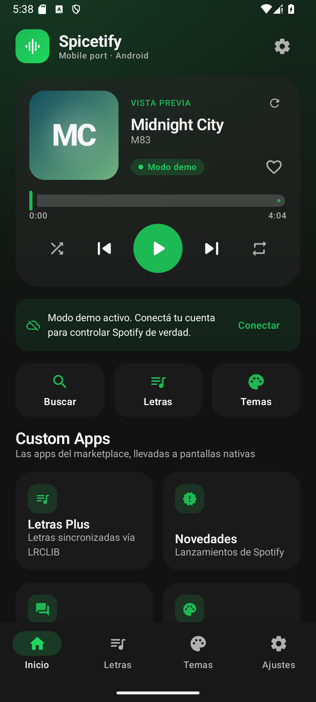
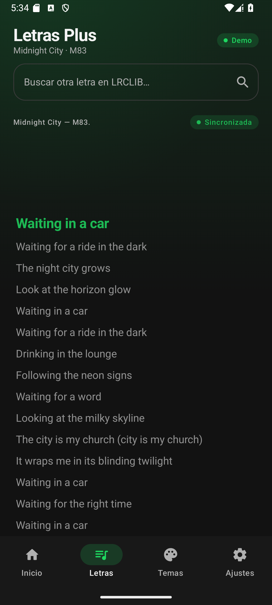
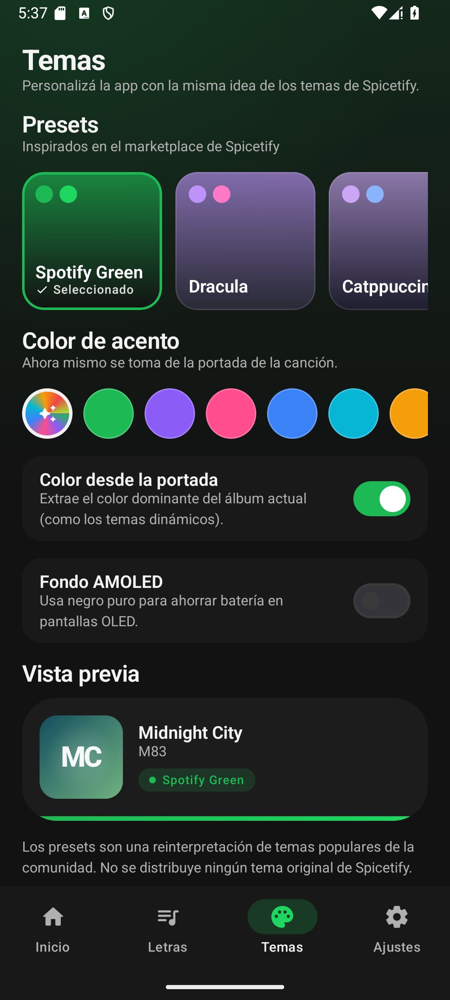
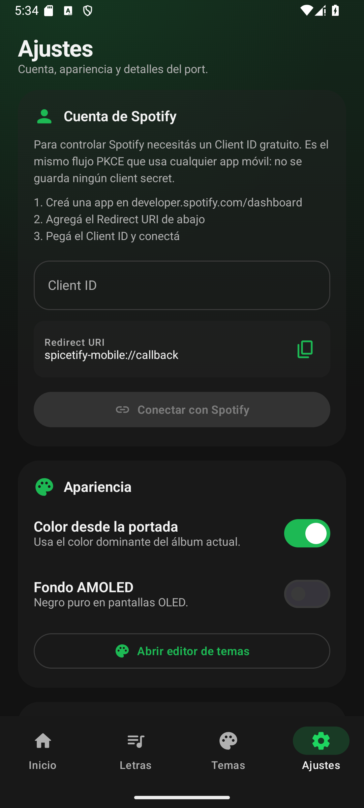
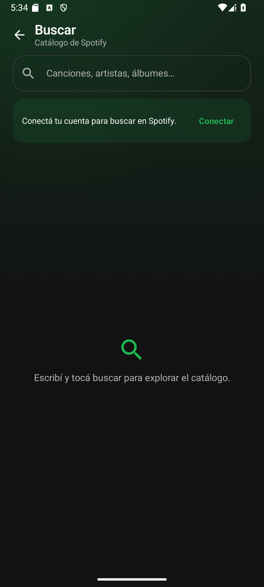
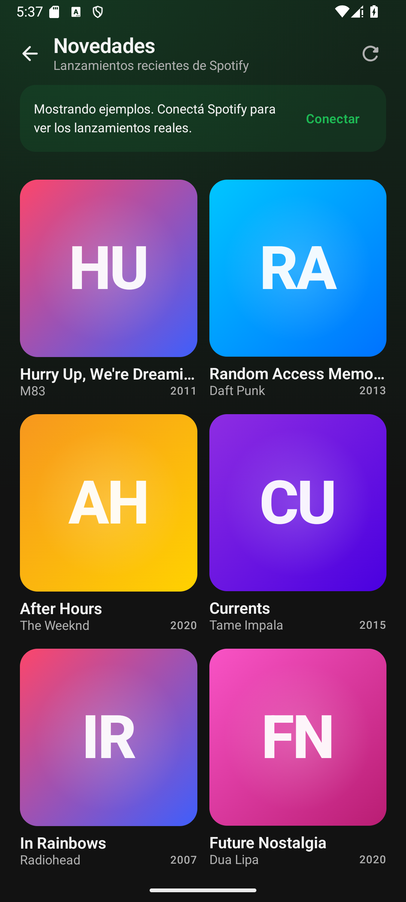

# Spicetify Mobile — port a Android

Port académico de **Spicetify CLI** a una app nativa de Android con **Kotlin + Jetpack Compose**.

> **Alcance real del port.** Spicetify CLI es una herramienta en Go que parchea el cliente de
> Spotify de **escritorio** (Electron): modifica `xpui.spa`, inyecta CSS/JS y extensiones.
> En Android, Spotify es una app nativa y no expone esos archivos, por lo que **no es posible
> aplicar el mismo parche**. Este proyecto porta el **concepto y la experiencia** de Spicetify a
> una app Android real, usando la **Web API oficial de Spotify** y **LRCLIB** para las letras.
> No modifica, parchea ni redistribuye la APK de Spotify.

---

## ✨ Funcionalidades

| Spicetify (escritorio) | Spicetify Mobile (Android) |
| --- | --- |
| Temas y colores personalizados | Temas Material 3 con presets inspirados en el marketplace |
| Color dinámico desde la portada | Extracción del color dominante del álbum actual |
| AMOLED / fondos oscuros | Interruptor de fondo AMOLED |
| Custom App `lyrics-plus` | Pantalla **Letras Plus** con letras sincronizadas (LRCLIB) |
| Custom App `new-releases` | Pantalla **Novedades** con los lanzamientos de Spotify |
| Custom App `reddit` | Pantalla **Reddit** con `r/spotify` embebido |
| Extensiones de control del reproductor | Play, pausa, siguiente, anterior, seek, shuffle y repeat |
| CLI en Go | App Android en Kotlin + Compose |

### Pantallas

- **Inicio:** reproductor con portada, progreso, controles y acceso rápido a las Custom Apps.
- **Letras Plus:** letras sincronizadas con auto-scroll, resaltado de la línea activa y “tocá para saltar”.
- **Temas:** presets, color de acento, color desde la portada, AMOLED y vista previa.
- **Ajustes:** conexión OAuth con Spotify (PKCE), estado de la cuenta, extensiones incluidas y créditos.
- **Buscar:** catálogo de Spotify (requiere cuenta conectada).
- **Novedades:** grilla de álbumes recientes.
- **Reddit:** WebView de `r/spotify`.

### Modo demo

Sin conectar la cuenta, la app funciona con datos de ejemplo (3 canciones y 6 álbumes) para poder
mostrar la interfaz durante la evaluación. Las letras sí se consultan a LRCLIB porque su API es pública.

### Capturas

Capturas reales tomadas desde el emulador (Android 15, modo demo):

| Inicio | Letras Plus |
| :---: | :---: |
|  |  |

| Temas | Ajustes |
| :---: | :---: |
|  |  |

| Buscar | Novedades |
| :---: | :---: |
|  |  |

---

## 🚀 Cómo compilar y ejecutar

### Requisitos

- Android Studio **Ladybug** o superior (o solo la SDK de Android).
- **JDK 17+** (probado con JDK 21).
- **Android SDK 35** (compileSdk 35) y **Build Tools 34+**.
- Dispositivo o emulador con **Android 8.0 (API 26)** o superior.

### Desde Android Studio

1. Abrir la carpeta `android/` como proyecto (no la raíz del repo).
2. Esperar a que Gradle sincronice.
3. Ejecutar la configuración `app` en un emulador o dispositivo.

### Desde la terminal

```powershell
cd android
.\gradlew assembleDebug
adb install -r app\build\outputs\apk\debug\app-debug.apk
```

APK generado en:

```
android/app/build/outputs/apk/debug/app-debug.apk
```

> En Linux/macOS usar `./gradlew assembleDebug`.
> Si Gradle no encuentra el SDK, creá `android/local.properties` con `sdk.dir=/ruta/al/Android/Sdk`
> (Android Studio lo genera automáticamente).

---

## 🔑 Conectar una cuenta de Spotify

La app usa **Authorization Code with PKCE**, el flujo recomendado para apps móviles: no requiere
guardar un client secret.

1. Entrar a <https://developer.spotify.com/dashboard> y crear una app.
2. En **Redirect URIs** agregar exactamente:

   ```
   spicetify-mobile://callback
   ```

3. En **APIs used** marcar **Web API**.
4. En **User Management** agregar el mail de la cuenta de Spotify que va a usar la app
   (el modo desarrollo permite hasta 25 usuarios).
5. Copiar el **Client ID** y pegarlo en **Ajustes → Cuenta de Spotify → Conectar con Spotify**.
6. Completar el login en el navegador y volver a la app.

### Permisos (scopes) solicitados

```
user-read-playback-state
user-modify-playback-state
user-read-currently-playing
user-read-private
user-read-email
user-library-read
user-library-modify
```

### Notas sobre la reproducción

- El **control remoto** de Spotify requiere **Premium** y un **dispositivo activo** (abrir Spotify
  en el teléfono o en la computadora y darle play una vez).
- Con una cuenta **Free** la app sigue funcionando para buscar, ver novedades y letras.
- El token se refresca automáticamente antes de vencer.

---

## 🧱 Arquitectura

```
android/
├── app/src/main/java/com/spicetify/mobile/
│   ├── MainActivity.kt              # edge-to-edge, deep link OAuth, tema raíz
│   ├── SpicetifyApp.kt              # Application + service locator
│   ├── AppGraph.kt                  # OkHttp, Json, repositorios
│   ├── data/
│   │   ├── SettingsRepository.kt    # DataStore: ajustes + tokens
│   │   ├── SpotifyAuth.kt           # PKCE, Custom Tabs, refresh token
│   │   ├── SpotifyApi.kt            # Web API (reproductor, búsqueda, novedades)
│   │   ├── LyricsRepository.kt      # LRCLIB + parser LRC
│   │   ├── ArtworkColorExtractor.kt # color dominante de la portada
│   │   ├── ThemePresets.kt          # presets de temas
│   │   ├── DemoData.kt              # datos para el modo demo
│   │   └── Models.kt
│   └── ui/
│       ├── AppViewModel.kt          # estado, polling, ticker, acciones
│       ├── SpicetifyNavHost.kt      # Navigation Compose + bottom bar
│       ├── theme/Theme.kt           # Material 3 dinámico
│       ├── components/              # reproductor, portada, banners
│       └── screens/                 # Inicio, Letras, Temas, Ajustes, Buscar, Novedades, Reddit
└── gradle/libs.versions.toml        # version catalog
```

**Stack:** Kotlin 2.0, Jetpack Compose (BOM 2024.12), Material 3, Navigation Compose, DataStore,
OkHttp, kotlinx.serialization, Coil, Custom Tabs.

### Decisiones de diseño

- **MVVM** con un `AppViewModel` que expone `StateFlow` y recibe eventos desde Compose.
- **Service locator simple** (`AppGraph`) en lugar de un framework de DI, para mantener el proyecto
  legible en una materia.
- **PKCE** sin client secret y **refresh automático** del token.
- **Modo demo** integrado para que la app nunca quede vacía durante una presentación.
- **Color dinámico**: se decodifica la portada en segundo plano y se calcula un color dominante
  ponderado por saturación/brillo.

### Endpoints usados

- `GET /v1/me/player`
- `PUT /v1/me/player/play`, `PUT /v1/me/player/pause`
- `POST /v1/me/player/next`, `POST /v1/me/player/previous`
- `PUT /v1/me/player/seek`, `PUT /v1/me/player/shuffle`, `PUT /v1/me/player/repeat`
- `GET /v1/me/tracks/contains`, `PUT/DELETE /v1/me/tracks`
- `GET /v1/search`, `GET /v1/browse/new-releases`, `GET /v1/me`
- `GET https://lrclib.net/api/get` y `/api/search`

---

## ⚠️ Limitaciones y nota legal

- **No** se puede inyectar CSS/JS en la app nativa de Spotify sin root, Xposed/LSPosed o modificar
  el APK; eso queda fuera del alcance de este port y de la consigna.
- No se descarga música, no se eluden anuncios ni las restricciones de Spotify Premium.
- El nombre “Spicetify” se usa solo de forma descriptiva. Este proyecto **no está afiliado** a
  Spicetify ni a Spotify.
- Las letras provienen de la base comunitaria **LRCLIB**.
- Los tokens se guardan en DataStore local (para producción conviene `EncryptedSharedPreferences`
  o el Android Keystore).
- El repositorio original es **LGPL-2.1**; este port se distribuye bajo la misma licencia.

---

## 🧪 Checklist para la evaluación

- [x] Compila con `gradlew assembleDebug`.
- [x] `gradlew lintDebug` pasa sin errores.
- [x] APK instalable en Android 8+.
- [x] UI completa con Material 3 y modo oscuro.
- [x] OAuth 2.0 PKCE con Spotify (login real desde el navegador).
- [x] Control del reproductor vía Web API.
- [x] Letras sincronizadas con LRCLIB.
- [x] Búsqueda y novedades.
- [x] Temas personalizables + color dinámico desde la portada.
- [x] Modo demo sin cuenta.
- [x] Documentación de arquitectura y pasos de compilación.

## 📄 Créditos

- Proyecto original: [spicetify/cli](https://github.com/spicetify/cli) (LGPL-2.1).
- Spotify Web API: <https://developer.spotify.com/documentation/web-api>.
- Letras: [LRCLIB](https://lrclib.net).
